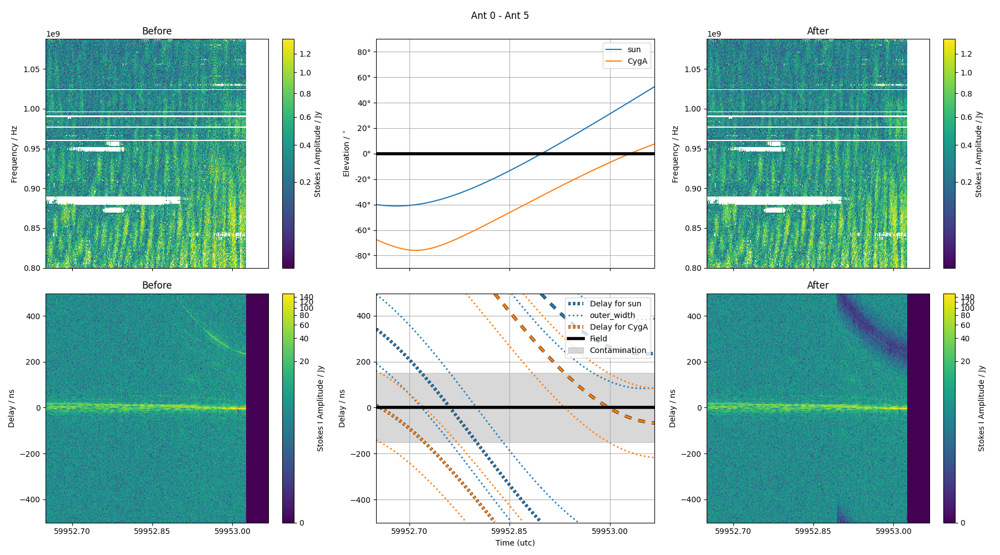
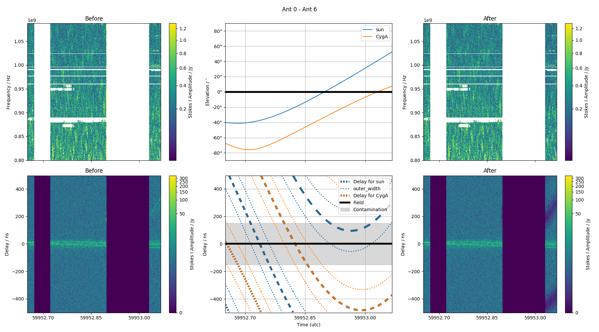
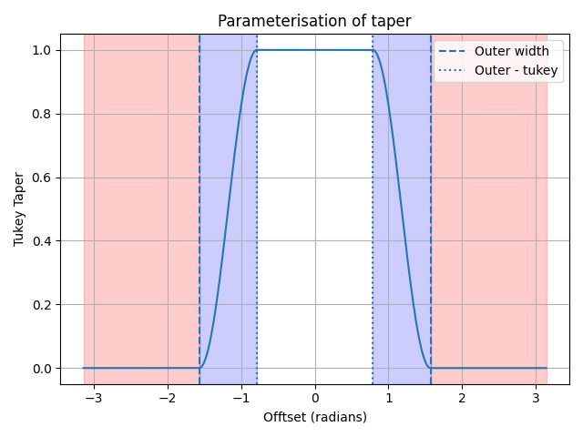
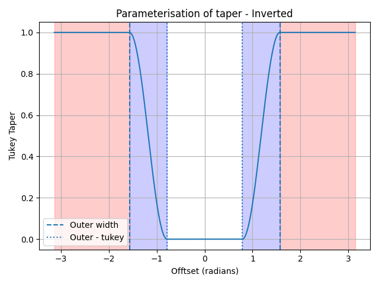

# Delay nulling (notch filter)
## How it works

In this mode the frequency data of each timestep/baseline is Fourier transformed to form a delay spectrum. `jolly-roger` will null the delays towards some nominated sky-direction. The expected delay of a bright source can be computed by examining the difference between the w-terms of the phased direction and the source direction. Multiple sky-directions may be set in a single `jolly-roger` invocation.

## Acceleration

The computation part of `jolly-roger` can be spread across multiple cores through data partitioning. This is mostly a best effort basis for the moment, but testing has shown upwards a 2-times speed up. On the command line the `--max-workers N` argument is used to set the number of threads (not processes) to use, where each thread is managing on compute operation against a chunk of rows.

Should this be used it is suggested to lower the `--chunk-size` to avoid excessive memory usage. Acceleration here relies on `numpy` operations releasing the GIL, so full CPU saturation is unlikely. Further, reading/writing through `casacore` is limited to the main thread, so can also act as a bottleneck.

Brief testing suggests that smaller batch sizes is preferable over larger when using `N > 4` number of workers, but this has not been thoroughly explored.

## Example

The nulling approach can be accessed through `jolly_tractor`. Examples of its application are below. The left and right columns indicate the before and after of the nulling procedure (here nulling towards the Sun's sky position). The top row shows the dynamic sopectrum (time vs frequency) while the bottom highlight the time vs delay of the data.

Sunrise was approximately in the middle of this observation, as indicated by the sudden excess power seen in the top left figure.

The red dashed lines in the lower panel represents the delay of the Sun as derived from the geometry of the array, with the length of each dash represents the Nyquist zone (i.e. how aliased the source appears in delay space). Nulling can be deactivated if the Nyquist zone of the object is high enough to effectively mean no contribution (typically the case for longer baselines).

Should the source cross over a delay of 0 then that timestep will be flagged, as the intermixed components can not be separated, and nulling would have an adverse effect of the direction being observed.

### Baseline ak01 to ak06


### Baseline ak01 to ak07


### Tukey Parameterisation


Internal `jolly-roger` uses a tukey window function to smoothly modify visibilities. This window function defines a region that smoothly changes from 1.0 to 0.0. We should in the above figure this specific window is parameterised in `jolly-roger`.

The `outer_width` parameter defines a boundary beyond which the window is all 0.0s. The `tukey_width` defines the interval over which the window function transitions from 1.0 to 0.0. This transition is described as `1 - cos`. Hence, a smaller `outer_width` will taper _more_ of the data, and a smaller `tukey_width` produces a window that transitions _quicker_.

If the `--taper-towards-object` argument is used the tukey taper is inverted to behave like a notch filter. So a smaller `outer_width` will _preserve_ more data. See the below figure.




## Python interface

The nulling can be used from Python without the CLI, either on a measurement set or directly on arrays.

- `tukey_tractor(ms_path, tukey_tractor_options)` runs the full `jolly_tractor tukey` process on a measurement set.
- `prepare_tractor(ms_path, tractor_options)` opens the measurement set, prepares the output column and predicts the delay of each object to null. `run_tractor_chunks(setup, chunk_func, tractor_options)` then reads the data in chunks of rows, passes each `DataChunk` to `chunk_func`, and writes the returned `TaperedChunkResult` back. Any nulling method can be run over a measurement set this way.
- `compute_tukey_multi_taper(data_chunk, tukey_tractor_options, w_delays_list)` applies the delay notch to one `DataChunk` and does no measurement set I/O. A `DataChunk` can be built directly from arrays: only `masked_data` (rows, channels, polarisations), `freq_chan`, `time_mjds`, `ant_1`, `ant_2` and `chunk_size` are used.
- `get_object_delay_from_tables` (or `get_object_delay_for_ms`) predicts the delay of each object for every baseline and time, as the `WDelays` passed to `compute_tukey_multi_taper`.

`TractorOptions` holds the options shared by every nulling method (columns, chunking, workers, plots, the field's guard band); `TukeyTractorOptions` adds the notch settings.

## Delay CLEAN

`jolly_tractor clean` (and `jolly_roger.deconvolve`) removes bright objects outside the field by CLEAN in delay, as an alternative to the notch. It needs the optional `rm-lite` dependency: `pip install 'jolly-roger[clean]'`.

```bash
jolly_tractor clean my.ms --target-objects sun --output-column CORRECTED_DATA
```

- Each visibility spectrum is transformed to delay with an FFT. The delay spread function (the delay spectrum of a point source) is the FFT of the channel weights, so flagged channels are accounted for exactly.
- A Hogbom CLEAN (`rm_lite.utils.clean.minor_loop`) runs over the whole delay axis. Its mask starts at the brightest emission and grows into connected emission above the noise, so the object's size, structure and spectrum need not be known.
- Only components outside the field's delay range are subtracted, so the field is not modified. The subtracted model is evaluated in every channel, including flagged ones.
- Rows where the subtracted emission runs into the field's delay range are flagged, because there the object and field cannot be separated.
- The noise sets the CLEAN mask and threshold. Unless it is given, it is estimated from each spectrum by `estimate_visibility_noise`: each long run of unflagged channels is windowed and transformed to delay, and a low quantile of the delay amplitudes is compared with the Rayleigh distribution of noise. Emission only raises the estimate, so it errs high (by about 20% next to an object 10^4 times brighter than the noise).

- Only rows where an object in `--target-objects` is above the elevation cut are cleaned. The field's delay range on each baseline is `--field-delay-ns` plus the guard band, which is sized from the field of view. The guard band is on by default for both `tukey` and `clean`; `--no-guard-field` turns it off.
- The run is summarised in the log and the measurement set's HISTORY table: how many spectra were cleaned and rows flagged; how bright a spectral line in the field must be before it is partly subtracted; and the residual left at the band edges compared with mid-band.

`delay_clean_spectrum` works on one spectrum, `compute_delay_clean` on a `DataChunk`, and `compute_clean_tractor` on a `DataChunk` with the objects' predicted delays, as passed to `run_tractor_chunks` by `clean_tractor`.

## CLI


```{argparse}
:ref: jolly_roger.tractor.get_parser
:prog: jolly_tractor
```
