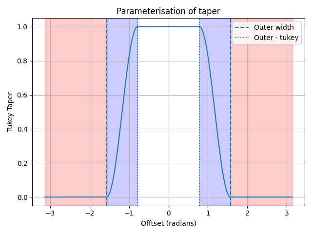
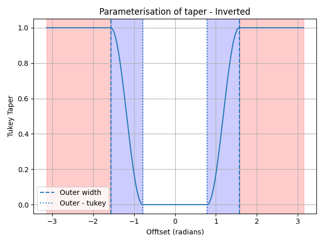

# Delay nulling (notch filter)
## How it works

In this mode the frequency data of each timestep/baseline is Fourier transformed to form a delay spectrum. `jolly-roger` will null the delays towards some nominated sky-direction. The expected delay of a bright source can be computed by examining the difference between the w-terms of the phased direction and the source direction. Multiple sky-directions may be set in a single `jolly-roger` invocation.

## Acceleration

The computation part of `jolly-roger` can be spread across multiple cores through data partitioning. This is mostly a best effort basis for the moment, but testing has shown upwards a 2-times speed up. On the command line the `--max-workers N` argument is used to set the number of threads (not processes) to use, where each thread is managing on compute operation against a chunk of rows.

Should this be used it is suggested to lower the `--chunk-size` to avoid excessive memory usage. Acceleration here relies on `numpy` operations releasing the GIL, so full CPU saturation is unlikely. Further, reading/writing through `casacore` is limited to the main thread, so can also act as a bottleneck.

Brief testing suggests that smaller batch sizes is preferable over larger when using `N > 4` number of workers, but this has not been thoroughly explored.

## Example

`jolly_tractor tukey` applies the notch. The example below nulls the Sun in 30 minutes of an ASKAP EMU observation around sunrise, and shows each baseline before and after. The figures are made from the data each time the documentation is built.

The dashed line in the middle panel is the Sun's delay, predicted from the array geometry. The length of each dash shows the Nyquist zone, i.e. how many times the object's delay wraps round the delay axis. Objects beyond `--ignore-nyquist-zone` are not nulled, which is typical on longer baselines. Where the object's delay comes within the field's guard region the two cannot be separated in delay, so the timestep is flagged; `--rate-filter` can recover many of these rows.

```{toctree}
:maxdepth: 1

nulling_example.ipynb
```

## Tukey Parameterisation


Internal `jolly-roger` uses a tukey window function to smoothly modify visibilities. This window function defines a region that smoothly changes from 1.0 to 0.0. We should in the above figure this specific window is parameterised in `jolly-roger`.

The `outer_width` parameter defines a boundary beyond which the window is all 0.0s. The `tukey_width` defines the interval over which the window function transitions from 1.0 to 0.0. This transition is described as `1 - cos`. Hence, a smaller `outer_width` will taper _more_ of the data, and a smaller `tukey_width` produces a window that transitions _quicker_.

If the `--taper-towards-object` argument is used the tukey taper is inverted to behave like a notch filter. So a smaller `outer_width` will _preserve_ more data. See the below figure.

Around each object the notch is widened by the object's half-width in delay, on each baseline and time:
- **The object's disc:** θ·|(u, v)|/c, with θ its angular radius from `--object-radius-deg`. By default the Sun is 0.5°, the Moon 0.27°, and any other object a point.
- **The primary beam's spread, D/c:** an object far outside the main lobe is seen through the beam's frequency-dependent sidelobes, which spread it over about D/c in delay. D is the dish diameter: `--dish-diameter-m`, else the largest DISH_DIAMETER. That is 40 ns for ASKAP's 12 m dishes; without this term the notch leaves most of the Sun on ASKAP data.

So the notch fully removes outer_width − tukey_width + the half-width either side of the object's delay. The run's log and HISTORY give each object's half-width. The same width sets `clean`'s band (see [Delay CLEAN](clean.md)).




## Python interface

The nulling can be used from Python without the CLI, either on a measurement set or directly on arrays.

- `tukey_tractor(ms_path, tukey_tractor_options)` runs the full `jolly_tractor tukey` process on a measurement set.
- `prepare_tractor(ms_path, tractor_options)` opens the measurement set, prepares the output column and predicts the delay of each object to null. `run_tractor_chunks(setup, chunk_func, tractor_options)` then reads the data in chunks of rows, passes each `DataChunk` to `chunk_func`, and writes the returned `TaperedChunkResult` back. Any nulling method can be run over a measurement set this way.
- `compute_tukey_multi_taper(data_chunk, tukey_tractor_options, w_delays_list)` applies the delay notch to one `DataChunk` and does no measurement set I/O. A `DataChunk` can be built directly from arrays: only `masked_data` (rows, channels, polarisations), `freq_chan`, `time_mjds`, `ant_1`, `ant_2` and `chunk_size` are used.
- `get_object_delay_from_tables` (or `get_object_delay_for_ms`) predicts the delay of each object for every baseline and time, as the `WDelays` passed to `compute_tukey_multi_taper`.

`TractorOptions` holds the options shared by every nulling method (columns, chunking, workers, plots, the field's guard band); `TukeyTractorOptions` adds the notch settings.

## Delay-rate filtering

`jolly_tractor tukey --rate-filter` recovers rows that the notch flags because an object is too close to the field in delay, provided the object is separated from the field in fringe rate.

- Consecutive flagged rows of each baseline, plus clean rows either side, are filtered together in delay and fringe rate. The region around each object's delay track and fringe-rate band is removed. The field's region, sized from the same field of view as the delay guard band, is kept.
- A row is recovered only if the object left in it is comparable to what the notch leaves on rows it does not flag. Rows near the ends of a run without clean neighbours, or that fail this check, stay flagged.
- Each run is filtered in segments long enough to separate every object from the field in fringe rate. The length needed depends on the baseline, the objects' fringe rates, the frequencies and the integration time, and each segment lasts twice that. Long runs are split into overlapping segments, so no recovered row is at the end of a segment.
- With `--make-plots`, each baseline's comparison plot has a third row, in fringe rate and delay, and up to `--number-of-plots` filtered segments are plotted with the region the filter removes and the field's guard region.

From arrays, `make_rate_filter_run`, `update_rate_filter` and `flush_rate_filter` (`jolly_roger.rates`) run the filter over chunks, and `filter_segment` filters one baseline's rows.

## CLI


```{argparse}
:ref: jolly_roger.tractor.get_parser
:prog: jolly_tractor
```
